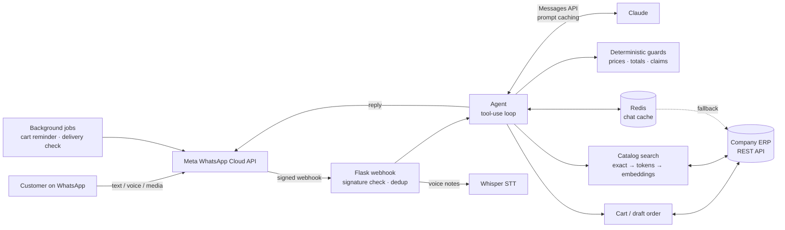

# WhatsApp AI Ordering Agent — Case Study

> A production, multi-tenant WhatsApp bot that lets customers browse a shop's catalog, build a cart,
> and place real orders by chatting naturally in English, Roman Urdu or Urdu. It handles text and voice notes.
> Built on Claude (Anthropic) with tool use, and wrapped in deterministic guardrails so the AI can
> never invent a product, misquote a price or place an order the customer didn't agree to.

**Author:** Muhammad Soban Hameed · **Role:** AI / Backend Engineer (design, implementation, production support)
**Status:** Live in production, serving multiple businesses (restaurants, pharmacies and retail shops)

> [!NOTE]
> **This repository is a case study, not the source code.** 
> The code samples are **simplified illustrations written for this document**, not excerpts from the real
> codebase. Company names, client names, endpoints, credentials and customer data are deliberately left out.

---

## The problem

Small businesses already take orders on WhatsApp, but by hand. Someone has to answer every
"menu bhej dein", work out the prices, take down the address and type the order into the ERP.
Messages arrive at all hours, often misspelt, mixed-language or as voice notes.

The goal was a bot that does this end to end **and writes real orders straight into the company's ERP**.
A wrong price or a phantom order costs the shop real money, so "mostly right" wasn't good enough.

## What I built

| Area | Highlights |
|---|---|
| **Conversational ordering** | Browse categories, search items, add, remove or change quantities ("one more", "make it 3"), choose add-ons, delivery details, special instructions, order summary, and placement on a plain "yes" |
| **AI agent** | Claude with **15 tools**, running in a tool-use loop. The model decides *intent*, and code owns money, cart state and order placement |
| **Guardrails** | Deterministic validators catch invented products or sizes, misquoted prices, wrong totals, false "order placed" claims and address mismatches. The model gets a corrective note and fixes its reply before the customer sees it |
| **Catalog search** | Three-stage matcher: exact match, then token and description match, then multilingual embeddings. It also handles synonyms, cross-language terms ("chawal" → rice) and heavy misspellings |
| **Need-based consultation** | "Something for a cough?" finds products from the shop's own descriptions. Answers stay grounded in that data, never in model knowledge |
| **Voice notes** | Whisper speech-to-text. A transcript is handled exactly like a typed message |
| **Multi-tenancy** | One deployment serves many businesses. Each has its own WhatsApp credentials, webhook secret, currency, tax name and catalog, with no restart needed when a tenant changes |
| **Lifecycle automation** | A one-time abandoned-cart reminder and a "did your order arrive?" check after delivery, both inside WhatsApp's 24-hour messaging rules |
| **Order management** | Order status, order history with combined totals, cancellation, and repeating a past order |
| **Cost tracking** | Token and audio-second usage is collected per order and reported for billing |

## Architecture at a glance

Read more in [docs/01-architecture.md](docs/01-architecture.md).

## Case study contents

| # | Document | What it covers |
|---|---|---|
| 1 | [Architecture](docs/01-architecture.md) | System components, request lifecycle, multi-tenancy, data ownership |
| 2 | [AI agent design & guardrails](docs/02-ai-agent-design.md) | Tool design, the agent loop, why code owns the money, correction laps, prompt caching |
| 3 | [Order lifecycle](docs/03-order-lifecycle.md) | Cart → checkout → confirmation as a state machine; drafts, add-ons, follow-ups |
| 4 | [Catalog search & consultation](docs/04-catalog-search.md) | The multi-stage matcher, embeddings, synonyms, need-based recommendations |
| 5 | [Reliability & operations](docs/05-reliability-and-operations.md) | Key rotation, caches that fail safe, auth, idempotency, deployment |
| 6 | [Production incidents](docs/06-production-incidents.md) | Real bugs from live traffic: symptom, root cause, fix and lesson |
| 7 | [Testing strategy](docs/07-testing.md) | Regression suites, replaying real conversations, never writing to production from tests |
| 8 | [Lessons learned](docs/08-lessons-learned.md) | What I'd tell anyone putting an LLM in front of real money |

## By the numbers

- **~17,000 lines** of Python across 20 modules
- **15** model-callable tools
- **35** regression test suites, many built from real production conversations
- **3** languages and scripts understood: English, Roman Urdu and Urdu
- **Multiple tenants** on one deployment, each with its own credentials, currency and catalog

## Tech stack

**Language and web:** Python 3.12, Flask, Gunicorn, Nginx (TLS)
**AI:** Anthropic Claude (Messages API, tool use, prompt caching), Whisper speech-to-text,
`sentence-transformers` (multilingual-e5) for embedding search
**Data:** the company ERP's REST API is the source of truth; Redis caches chats; small local ledgers live on disk
**Messaging:** Meta WhatsApp Cloud API (webhooks, HMAC signature verification)
**Infrastructure:** Docker and Docker Compose, JWT bearer auth with refresh, structured logging
**Validation:** Pydantic, `phonenumbers`

## Engineering principles I followed

1. **The model decides what the customer means, and code decides what happens.** Prices, totals, cart
   contents and order placement are never taken from model output.
2. **Irreversible actions need unambiguous consent.** An order is placed only when the whole message is a
   confirmation, never because "yes" appears somewhere in a longer sentence.
3. **Every cache must fail safe.** If a cache is down, it should look exactly like an empty cache.
4. **Fix root causes, not symptoms.** Most production bugs came from two parts of the system disagreeing,
   such as two clocks, two copies of state or two retry loops. The fix was to pick one source of truth,
   not to add another patch.
5. **Real conversations become tests.** Every production incident turned into a regression test.

---

*Want to talk about this project? Find me on GitHub: [@MuhammadSobanHameed](https://github.com/MuhammadSobanHameed).*
