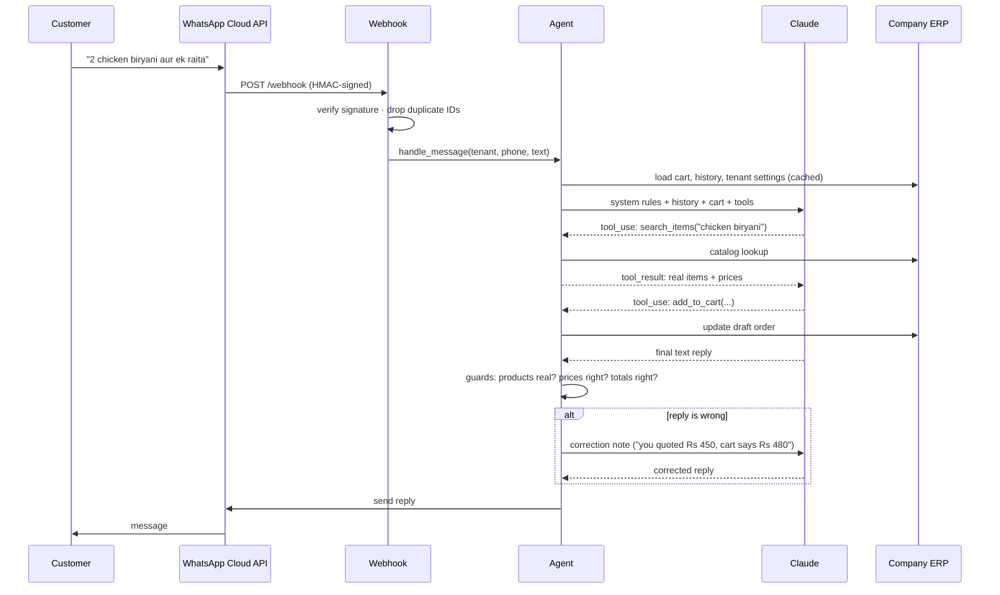

# 1. Architecture

[← Back to README](../README.md)

## Components

| Component | Responsibility |
|---|---|
| **Webhook server** (Flask + Gunicorn) | Receives Meta webhooks, verifies their signatures, removes duplicate deliveries, sends quick acknowledgements and hands each message to the agent |
| **Agent** | Builds the prompt from the shop's rules, the conversation history and the current cart, then runs the Claude tool-use loop and applies the guards before replying |
| **Tools layer** | 15 Python functions the model can call: search, cart edits, add-ons, delivery details, order placement, status, history and cancellation |
| **Guards** | Deterministic checks on the model's draft reply. They compare it with the real cart and catalog and send it back for correction if it's wrong |
| **Catalog search** | A multi-stage matcher over the tenant's items, with an embedding fallback |
| **Draft orders** | The cart, stored as a *Draft* order in the ERP so the shop can see open carts live |
| **Memory** | Conversation history. The ERP API keeps the durable copy and Redis provides fast reads |
| **Background jobs** | The abandoned-cart reminder and the post-delivery check |
| **Speech-to-text** | Turns voice notes into text, which then follows the normal pipeline |

## Request lifecycle



## Multi-tenancy

One deployment serves many businesses. Every incoming webhook names the WhatsApp *business number*
it was sent to, and that is how the tenant is identified:

1. Business number → tenant ID (looked up from the ERP and cached).
2. Tenant ID → WhatsApp access token, phone-number ID and app secret (cached).
3. Tenant ID → currency, tax label, catalog and rules (cached).

All tenant state is looked up per message. Nothing tenant-specific is set at startup, so a shop can
be added, change its number or be removed **without a restart**. Getting cache expiry right here
caused one of the more interesting production bugs; see
[incident #6](06-production-incidents.md#6-a-removed-number-kept-answering).

The currency and tax label for the current message live in a `ContextVar`. The deepest rendering code
can read them without passing a tenant ID through every function, and two customers handled at the same
time can't see each other's currency.

```python
# Illustrative
_money_ctx: ContextVar[Money] = ContextVar("money")

def handle_message(tenant_id, phone, text):
    _money_ctx.set(Money.for_tenant(tenant_id))   # "Rs" / "£" / "₹", "GST" / "VAT"
    ...

def format_price(amount: float) -> str:
    m = _money_ctx.get()
    return f"{m.symbol} {amount:,.0f}"
```

## Where data lives

| Data | Source of truth | Why |
|---|---|---|
| Catalog, customers, orders | Company ERP (REST) | The shop runs its business from the ERP portal. The bot is just another client of it |
| Cart | A *Draft* order in the ERP | The shop sees open carts live, and they survive restarts |
| Conversation history | ERP memory API, with Redis as a read cache | Durable writes and fast reads. Redis can disappear without losing anything |
| "Already asked" flags (add-on offers, reminders, delivery checks) | Small JSON ledgers on a mounted volume | Each one exists to stop a customer being asked the same thing twice, so it has to survive a container restart |
| Usage per order (tokens, audio seconds) | Kept locally, then posted when the order is placed | Losing it would mean under-billing, and it can't be rebuilt |

## Deployment

- Docker Compose runs the bot and Redis. Nginx on the host handles TLS and proxies to the container.
- Volumes hold the duplicate-message IDs, the ledgers and the embedding model cache, so a rebuild doesn't
  re-download the ~470 MB model or forget which messages it has already processed.
- Container logs are size-capped so the disk can't fill up.
- HTTP access logging is on, so "Meta never delivered the message" can be told apart from
  "we received it and dropped it".

[Next: AI agent design & guardrails →](02-ai-agent-design.md)
