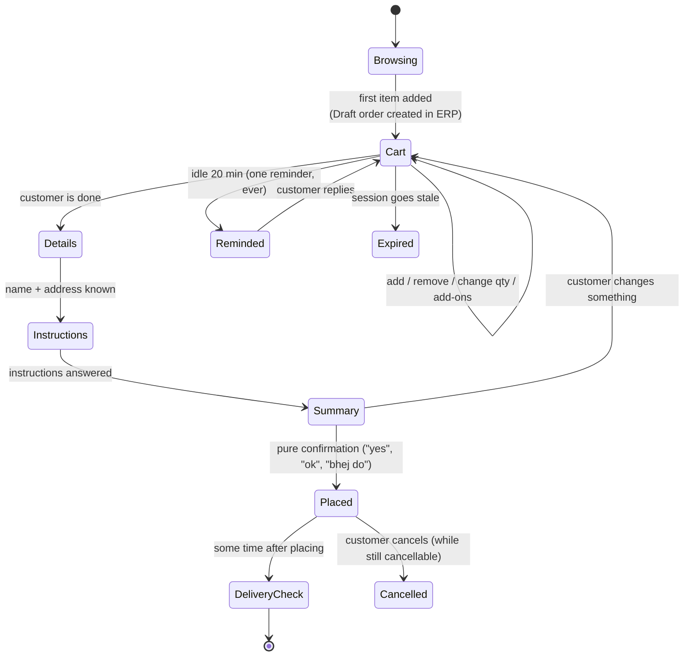

# 3. Order Lifecycle

[← Back to README](../README.md)

## The states



## The cart is a real order

The cart isn't kept only in the bot's memory. It is stored in the ERP as an order with status
**Draft**. This gives two things:

- **The shop sees open carts live** in its own portal and can follow up on them.
- **The cart survives restarts and deploys.** A container restart in the middle of a chat loses nothing.

Every cart line stores the real item ID, unit price and selected add-ons, all resolved from the catalog
by code. The model only ever refers to products by name.

## Placing the order: confirm in place

The first version placed an order by creating a **new** order and deleting the draft. That worked,
but the ERP gives a number to every order it creates, including drafts. So every placed order left a
gap in the shop's order numbers, and an order could briefly exist twice.

The fix was to **confirm the draft in place**: one update to the same order, which changes its status
to *Order Received* and fills in the delivery details. The order number the shop sees is the one the
cart already had.

```python
# Illustrative
def place_order(tenant, phone, details):
    draft = carts.get_draft(tenant, phone)
    body = build_order_body(draft, details, status="Order Received")
    body["orderNo"] = draft.order_no               # keep the number
    body["idempotencyKey"] = draft.idempotency_key # same logical order
    for line in body["lines"]:
        line.setdefault("selectedModifiers", "[]") # explicit "none", so nothing is silently kept
    erp.put(f"/orders/{draft.id}", json=body)
    carts.forget_locally(tenant, phone)            # the order now lives on, so don't delete it
```

One subtle point is the add-ons. The ERP's update endpoint once dropped a line's add-ons unless they
were sent again. Every line now states its add-ons explicitly, with `"[]"` meaning "none", and a local
ledger can restore them if a row ever comes back without them.

## Never placing the same order twice

The cart is cleared the moment an order is saved. In one early production chat, the customer sent their
name and address **after** the order had saved with placeholder details. The model saw an empty
cart and a customer giving delivery details, so it rebuilt the cart and placed the order a second time.

The fix was a short-lived record of the order just placed: its ID and a fingerprint of exactly what was
bought. It is kept on disk, so a restart between two messages can't lose it, and it expires with the
session. The next turn can then see "an order was just placed" and treat the details as an update to
that order.

## Add-ons

Add-ons, such as raita with a biryani, are offered **once per item per cart**. A small ledger
records which questions are still waiting for an answer. Its main job is this:

> A bare "yes" only answers an **open** add-on question.

Without the ledger, "yes" to *"anything else?"* could quietly add a paid extra the customer never
agreed to.

## Follow-ups

Two background jobs message customers outside a live conversation. Both follow the same three rules:

1. **Once, ever.** The record is written *before* the message is sent, so a crash mid-send costs a
   missed message rather than a customer messaged twice.
2. **Only inside WhatsApp's 24-hour window**, timed from the customer's last message. That is the only
   clock in the system that can be fully trusted (see [incident #4](06-production-incidents.md#4-the-backend-clock-was-hours-in-the-future)).
3. **Never while the customer is mid-conversation**, so a reminder can't land while a reply is being
   written.

| Job | Trigger | Outcome |
|---|---|---|
| Abandoned-cart reminder | Cart idle for 20 minutes | One friendly reminder. A reminded cart stays alive long enough for the customer to answer it |
| Delivery check | Some time after the order is placed | "Did your order arrive?" The yes/no answer is written back to the order, so the shop hears about failed deliveries from the customer |

## After the sale

- **Order status:** the ERP's status is translated into a friendly message.
- **Order history:** the recent orders (not just the last one) with combined totals, because
  customers often place two orders and then ask "how much do I owe?".
- **Cancellation:** only while the order is still in a status where it can be cancelled.
- **Repeat order:** "same as last time" rebuilds the cart from a past order at **today's** prices, and
  skips anything no longer sold.

## Messages that aren't text

Images, stickers, locations, contacts and documents each get a short, friendly reply that points the
customer back to ordering by text or voice. They are saved in the conversation so the model has
context later. Voice notes are transcribed and handled exactly like typed text.

[← AI agent design](02-ai-agent-design.md) · [Next: Catalog search →](04-catalog-search.md)
