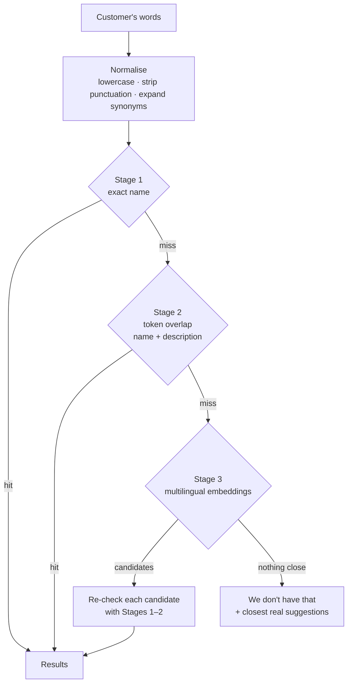

# 4. Catalog Search & Consultation

[← Back to README](../README.md)

Customers don't type catalog names. They type "chiken briyani", "chawal", "2 wali pizza",
"woh cough wala syrup", or a brand name the shop sells under a different spelling. Search has to
find the right item and also say clearly **"we don't have that"** when the item isn't sold.

## A staged matcher



**Stage 1 (exact):** a fast path for the common case where the name is right.

**Stage 2 (tokens):** word overlap against item names, then against descriptions. A hit on a
synonym (for example "roti" → "chapati") takes priority over a weaker description-only hit.

**Stage 3 (embeddings):** `multilingual-e5-small` via `sentence-transformers`, with an index built per
tenant. It catches what words alone can't: bad misspellings, and cross-language terms like
*chawal* for rice. It is **only allowed to suggest candidates.** Every candidate is checked again by the
deterministic stages, and the real item ID and price always come from there.

```python
# Illustrative
def search(tenant, query):
    q = expand_synonyms(normalise(query))
    hits = exact(tenant, q) or token_match(tenant, q)
    if hits:
        return hits
    candidates = vector_index(tenant).nearest(f"query: {q}", top_k=TOP_K, min_score=MIN_SCORE)
    return [item for c in candidates if (item := resolve_exact(tenant, c.name))]
```

A small detail that mattered: e5 models expect `query:` and `passage:` prefixes. Leaving them out
made results noticeably worse in testing. The prefixes are only added when the model's name shows it
was trained with them, so the model can be swapped without breaking search.

## Closeness, not just similarity

For "did you mean…?" suggestions, the code compares the customer's words with **the whole item name**.
A suggestion is made only if it is clearly ahead of the next one:

- the score must be at least **0.8**, and
- it must beat the runner-up by at least **0.1**.

Otherwise the bot asks the customer to pick. Choosing for them would be a guess presented as a fact.

## "We don't have that"

The model used to fill gaps by inventing items: asked for something that wasn't sold, it would
offer a believable menu item that didn't exist. Two changes fixed this:

1. Search returns an explicit **"not sold here"** result, along with the closest real alternatives.
2. The *invented products* guard checks every item name in the reply against the catalog and
   sends back any reply that mentions something that doesn't exist.

## Need-based consultation

For shops like pharmacies, customers describe a **need**, not a product: "something for cough",
"dry skin", "heat stress".

- The search tool accepts a `need` instead of a product name. It matches the need against item
  **descriptions** that the shop wrote, groups variants of the same product together, and returns a short list.
- The prompt only allows the model to recommend what the search returned and to describe it **only
  from the shop's own description**. It must not add medical claims from its general knowledge.
- If nothing matches, the customer hears exactly that. Nothing gets made up to fill the gap.

The catalog content mattered as much as the code here. I also wrote a structured description for each
product (what it's used for, its key ingredients and who it suits) so consultation had good data to search.

[← Order lifecycle](03-order-lifecycle.md) · [Next: Reliability & operations →](05-reliability-and-operations.md)
